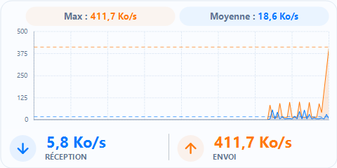
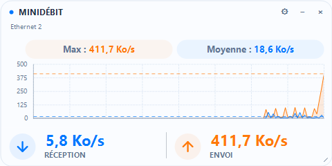
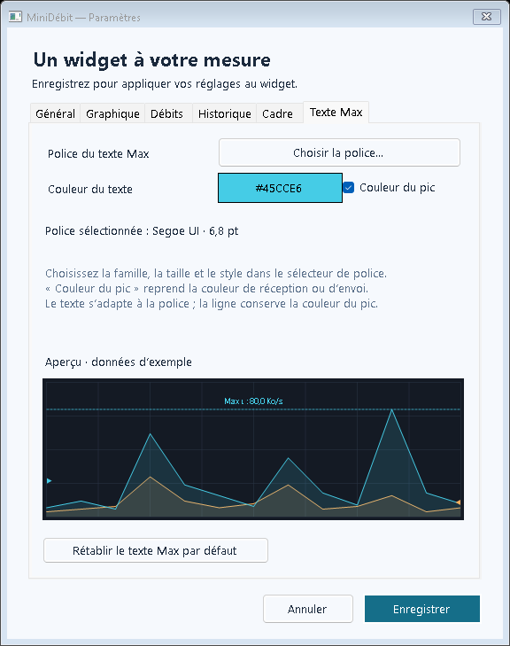

<div align="center">


<p><strong>Un widget discret pour suivre votre trafic réseau en temps réel.</strong><br />
Un graphique lisible, des valeurs stables et une apparence à votre mesure.</p>

<p>


</p>

<p><a href="#demarrage">Démarrer</a> · <a href="#utilisation">Utiliser</a> · <a href="#reglages">Personnaliser</a> · <a href="#historique">Historique</a> · <a href="#developpement">Compiler</a></p>

</div>

## ✨ À découvrir

| | MiniDébit au quotidien |
|---|---|
| 📈 **Trafic en direct** | Courbes de réception et d’envoi, maximum et moyenne sur la période affichée. |
| 🫧 **Valeurs plus calmes** | Lissage adaptatif : stable sous 1 Mo/s, réactif au-dessus. |
| 🎨 **Votre apparence** | Couleurs, polices, grille, cadre, marges et bandeau compact. |
| 🪟 **Une présence discrète** | En-tête au survol, zone de notification et accrochage aux bords de l’écran. |
| 🗃️ **Des données conservées** | Chaque mesure enregistrée dans SQLite ; export CSV du graphique. |
| ⚙️ **Des réglages indépendants** | Fréquence des mesures, période du graphique et lissage configurés séparément. |

## 🖼️ Aperçu

Les captures suivantes utilisent des données de démonstration. Le widget réel affiche le trafic mesuré sur la carte sélectionnée.



Au survol :



<a id="demarrage"></a>

## 🚀 Démarrage rapide

1. Ouvrir **Lancer.cmd** depuis le projet, ou **MiniDebit.exe** depuis le dossier de distribution.
2. Le widget apparaît directement ; choisir la carte réseau dans les paramètres si nécessaire.
3. Faire un clic droit ou un double-clic sur le widget pour le personnaliser.

Double-cliquer sur **Lancer.cmd**, ou sur **dist\MiniDebit\MiniDebit.exe**. Garder les fichiers du dossier `dist\MiniDebit` ensemble.

Le widget s’affiche directement au démarrage lorsque **Général → Au lancement → Afficher le widget** est coché, comme dans la configuration par défaut. Décocher cette option permet un lancement masqué si souhaité. L’exécutable et la zone de notification utilisent la même icône MiniDébit, intégrée en neuf tailles de 16 à 256 px ; aucun fichier image externe n’est nécessaire pour lancer le programme. Le dessin est régénérable avec `tools\create-icon.ps1`.

L’application utilise **C# / WinForms et .NET 10 Desktop**. Ce runtime est déjà installé sur l’ordinateur utilisé pour la compilation. Sur un autre PC Windows 10/11, installer le [runtime .NET 10 Desktop](https://dotnet.microsoft.com/fr-fr/download/dotnet/10.0) correspondant à l’architecture. Le SDK est nécessaire uniquement pour compiler. Aucun droit administrateur n’est demandé par MiniDébit.

La distribution inclut le programme, ses fichiers .NET et ce guide ; elle n’embarque pas le runtime afin de garder le téléchargement et le dossier très petits.

<a id="utilisation"></a>

## 🖱️ Utilisation

- **Glisser la fenêtre** pour la déplacer ; tirer son coin inférieur droit pour la redimensionner.
- Pendant le déplacement, le widget **accroche aux quatre bords** à environ 8 px (adaptés à la mise à l’échelle Windows). Éloigner la souris du bord le détache, même en déplaçant lentement la souris. Le point de prise initial reste la référence pendant tout le déplacement. Le widget reste dans la zone utilisable du moniteur sous le pointeur, au-dessus d’une barre des tâches en bas ou à côté d’une barre latérale. Déplacer le pointeur sur un autre écran pour y faire passer le widget. **Général → Déplacement → Accrocher aux bords de l’écran**, activé par défaut, permet de désactiver ce comportement. La position est mémorisée à la fin du déplacement.
- Le **bandeau supérieur** (titre, carte réseau et boutons) apparaît uniquement lorsque la souris survole le widget. Hors survol, le graphique récupère cet espace ; les débits restent visibles en bas.
- **Roue dentée**, **double-clic** ou **clic droit → Paramètres** : configurer le widget.
- Si le widget est visible, les paramètres s’ouvrent à côté, avec un espace de 12 px adapté à l’échelle Windows. Le placement cherche une place libre à droite, à gauche, au-dessus ou au-dessous, puis sur les autres écrans, en respectant la barre des tâches. Si les dimensions des écrans ne permettent aucune disposition sans recouvrement, il minimise la surface recouverte.
- **−** ou **Échap** : masquer le widget dans la zone de notification près de l’horloge. Son icône peut se trouver dans le menu des icônes masquées de Windows.
- **Double-clic sur l’icône** : afficher le widget.
- **×** ou **Quitter** : arrêter l’application.
- **Clic droit** : activer le premier plan, remettre les compteurs à zéro ou exporter le graphique en CSV.
- Survoler le widget : consulter les volumes reçus/envoyés depuis le lancement ou la dernière remise à zéro.

La position, les dimensions et les paramètres sont mémorisés dans `%LOCALAPPDATA%\MiniDebit\settings.json`. Fermer l’application puis supprimer ce fichier pour retrouver les valeurs par défaut.

Les nouvelles installations utilisent le profil intégré `Bandwidth/Assets/default-settings.json`, repris des réglages du widget : format 322 × 174, thème clair, opacité 90 %, bandeau compact, police des débits 16 px, texte Max 11 px, période 3 minutes et mesures toutes les secondes. La carte est choisie automatiquement et la position est calculée pour le nouvel écran. Les réglages déjà enregistrés restent prioritaires. Le profil est inclus dans le programme, sans fichier supplémentaire à installer.

**Débits → Lissage des valeurs** propose Désactivé, Léger (par défaut), Modéré et Fort. Il stabilise uniquement les deux débits sous la courbe. Les mesures, SQLite, le graphique, Max, Moyenne et les informations de débit de la zone de notification restent réels. Sous **1 Mo/s (1 000 000 octets/s)**, les constantes de temps sont de 5, 8 et 12 secondes ; au-dessus, elles passent à 0,35, 0,5 et 0,75 seconde pour réagir rapidement. Réception et envoi sont traités séparément. Le retour depuis un débit élevé est également rapide. Le filtre suit la durée réellement écoulée, indépendamment de la fréquence des mesures et du choix octets/bits. Les petits débits ne sont plus accélérés par les variations relatives de plus de 50 %. Une interface indisponible remet les valeurs à zéro au prochain relevé ; la première mesure, un changement de carte et une remise à zéro repartent sans ancienne valeur résiduelle.

L’espace à gauche du graphique est calculé selon la largeur réelle des graduations, avec 3 px entre le texte et l’axe. Le réglage de marge reste applicable ; les graduations décimales et les unités en bits sont prises en compte.

Au survol, le nom de la carte peut afficher son **IPv4 publique entre parenthèses**, par exemple `Ethernet 2 (203.0.113.42)`. **Général → Adresse externe → Afficher l’IPv4 publique**, activé par défaut, permet d’activer ou de désactiver cette information. Désactiver masque immédiatement l’adresse et annule la recherche en cours ; aucune nouvelle requête n’est lancée.

La recherche HTTPS utilise le service [ipify](https://www.ipify.org), en arrière-plan, au lancement, lorsque la carte ou son IPv4 locale change, puis toutes les dix minutes. Le socket est lié à l’IPv4 locale et à l’interface Windows sélectionnée ; aucun proxy système ni basculement sur une autre carte n’est utilisé. Après un échec, le délai avant réessai est d’une minute, avec huit secondes maximum par tentative. L’IPv4 publique est celle observée par le service sur cette connexion : elle peut appartenir au routeur ou à une sortie VPN, et différer de l’IPv4 locale de la carte.

Si la carte est hors ligne, sans IPv4 ou sans accès à ce service, le nom reste affiché seul. Le mode cumul de plusieurs cartes ne présente pas une adresse publique unique. Les débits, le graphique et SQLite continuent de fonctionner indépendamment de la recherche ; l’adresse publique n’est pas enregistrée dans la base.

<a id="reglages"></a>

## 🎛️ Réglages et apparence

| Onglet | Ce que vous pouvez régler |
|---|---|
| **Général** | Carte réseau, actualisation, période, unités, thème, opacité et comportement de la fenêtre. |
| **Graphique** | Couleurs, traits, remplissage, grille, marges et repères Max / Moyenne. |
| **Débits** | Police, couleurs, bandeau compact et lissage adaptatif. |
| **Historique** | Enregistrement SQLite et durée de conservation. |
| **Cadre** | Visibilité, couleur, épaisseur et style de la bordure. |
| **Texte Max** | Police des pastilles et couleur du texte du maximum. |

<details>
<summary><strong>Voir les captures et les détails des réglages</strong></summary>


L’onglet **Général** regroupe les paramètres de mesure et du widget. L’onglet **Graphique** permet de personnaliser les couleurs de réception, d’envoi, du fond et de la grille, l’épaisseur des courbes (0,5 à 6 px), leur style (continu, pointillé ou tirets), la présence et le style de la grille, ainsi que le remplissage et son opacité (0 à 100 %). « Auto (thème) » fait suivre au fond et à la grille le thème clair ou sombre.


**Graphique → Marge du graphique (px)** règle l’espace autour du graphique, de **0 à 20 px**, avec **1 px dans le profil livré** pour gagner de la surface d’affichage. Le réglage s’applique aux quatre côtés, avec ou sans survol, et l’aperçu réagit immédiatement. La marge s’ajoute à la place nécessaire aux axes et aux angles arrondis. À zéro, le cadre reste visible s’il est activé ; dans un petit widget, les marges verticales sont limitées si nécessaire pour conserver un graphique lisible. La valeur est mémorisée avec les autres paramètres et suit la mise à l’échelle Windows.

Le **maximum observé sur la période visible** apparaît dans une pastille au-dessus du graphique, avec une ligne horizontale en tirets. Sa couleur correspond à la courbe qui a produit ce pic. Réception et envoi sont comparés sans être additionnés. **Graphique → Repères de la période → Maximum** masque ou affiche la pastille et la ligne. Un maximum hors échelle reste lisible dans la pastille ; sa ligne est masquée.

La pastille **Moyenne** affiche le débit moyen total (réception + envoi), avec un repère horizontal bleu. Les deux moyennes séparées restent consultables dans l’infobulle. **Graphique → Repères de la période → Moyenne** masque ou affiche la pastille et le repère. Les pastilles occupent une bande dédiée au-dessus des courbes, sans les recouvrir.

Le calcul utilise uniquement les mesures de la période visible, pondérées par leur durée réelle, avec l’intervalle à cheval sur le début de période limité à sa partie visible. Au démarrage, il utilise la durée déjà mesurée, sans ajouter des zéros pour le passé absent. L’affichage suit les unités du widget et reste visible hors survol.

L’onglet **Texte Max** personnalise la police des pastilles (famille, taille, gras, italique, souligné et barré) et la couleur du maximum. **Couleur du pic** reprend la couleur de la courbe du maximum. L’aperçu reflète les changements ; le texte se réduit si nécessaire dans une petite fenêtre. Une police absente est remplacée par Segoe UI.



L’aperçu réagit aux réglages avant leur enregistrement et utilise des données d’exemple. **Enregistrer** applique et mémorise les changements ; **Annuler** laisse l’apparence du widget intacte. **Rétablir l’apparence par défaut** ne remet à zéro que les réglages du graphique, après enregistrement.

L’onglet **Débits** configure le bandeau inférieur : couleur du fond, police (famille, taille et style) et couleur du texte des valeurs et des libellés Réception / Envoi. **Fond graphique**, activé par défaut, reprend automatiquement la couleur du graphique, y compris ses changements ultérieurs. **Auto (contraste)** reprend la couleur de chaque courbe pour les valeurs et une couleur lisible pour les libellés ; une couleur personnalisée peut aussi être choisie. Les flèches gardent les couleurs des courbes. L’aperçu permet de contrôler le rendu avant d’enregistrer. Une police absente sur un autre ordinateur est remplacée par Segoe UI.


Dans **Débits → Bandeau compact**, cocher **Réduire les marges verticales** pour resserrer le bandeau, en conservant les valeurs et les libellés. Sa hauteur s’adapte à la police choisie ; l’espace libéré revient au graphique. L’aperçu reflète cette hauteur et l’option est mémorisée après enregistrement. Le mode compact est sélectionné dans le profil livré.

</details>

| Réglage | Valeurs |
|---|---|
| Carte réseau | Automatique, carte précise ou cumul des cartes actives |
| Actualisation | 250 à 5 000 ms ; 1 000 ms par défaut |
| Période affichée | 0,25 à 60 minutes (15 secondes à 1 heure) ; 3 minutes dans le profil livré |
| Unités | Octets/s (Ko/s, Mo/s) ou bits/s (Mbit/s, Gbit/s) |
| Apparence | Sombre ou claire |
| Opacité | 35 à 100 % ; 90 % dans le profil livré |
| Lissage des valeurs | Désactivé, Léger, Modéré ou Fort ; Léger par défaut |
| Échelle verticale | Automatique, ou plafond fixe en Mbit/s |
| Premier plan | Activé ou désactivé |
| Au lancement | Widget visible ou uniquement icône près de l’horloge |

Le mode automatique favorise une carte Ethernet/Wi-Fi active avec une passerelle. Pour choisir exactement le lien à surveiller, sélectionner sa carte explicitement. Le cumul peut compter deux fois un trafic traversant une carte VPN et sa carte physique ; il faut donc privilégier une seule carte pour cette utilisation. Une sélection explicite indisponible affiche zéro jusqu’à sa reconnexion ; elle ne bascule pas sur une autre carte.

Les unités sont décimales : **1 Ko = 1 000 octets ; 1 Mo/s = 8 Mbit/s**. Un plafond fixe peut couper visuellement les pics du graphique ; les valeurs numériques continuent d’afficher le débit mesuré.

MiniDébit observe le trafic total de la carte, y compris les échanges locaux. Il ne mesure pas la vitesse maximale de la connexion Internet et ne sépare pas le trafic par application. Il ne lance aucun téléchargement de test. Le changement de carte remet les volumes de session et le graphique à zéro.

La **période affichée** règle la vitesse du défilement, indépendamment de l’**actualisation des mesures**. Avec 5 minutes, le graphique défile cinq fois plus lentement qu’avec une minute, tout en continuant de mesurer et d’afficher les débits toutes les 1 000 ms par défaut. Le réglage se trouve dans **Paramètres → Période affichée (min)**. Une période plus longue se remplit progressivement avec les nouvelles mesures ; le programme ne peut pas reconstituer des données déjà supprimées. Lors de la mise à jour, l’ancienne valeur de 60 secondes devient 5 minutes ; une autre période personnalisée et le délai de mesure sont conservés.

Les points du graphique restent en mémoire et leur nombre est borné. Le CSV contient uniquement la période encore affichée, avec horodatage et débits en octets/s. Il ne contient pas le contenu des paquets.

## 🪟 Cadre de la fenêtre

L’onglet **Cadre** permet d’afficher ou de masquer la bordure autour de toute la fenêtre, de choisir sa couleur, son épaisseur (**0,5 à 8 px**) et son style (**continu, pointillé ou tirets**). Le profil livré utilise un cadre continu de 1 px, couleur `#DFE8F2`. L’option de couleur automatique permet de suivre le thème. L’épaisseur suit la mise à l’échelle Windows et réserve sa place autour du graphique et du bandeau des débits. Le cadre reste visible hors survol.


L’aperçu réagit aux réglages ; **Enregistrer** applique et mémorise le cadre, **Annuler** conserve le cadre actuel. **Rétablir le cadre par défaut** ne change que ces paramètres, après enregistrement.

<a id="historique"></a>

## 🗃️ Historique SQLite

L’onglet **Historique** permet d’activer l’enregistrement de **chaque mesure**, au délai d’actualisation configuré, et de choisir une conservation de **1 à 90 jours**, avec **7 jours par défaut**. L’enregistrement est activé par défaut. Il continue lorsque le widget est masqué.


La base est `%LOCALAPPDATA%\MiniDebit\traffic.sqlite`. La table `measurements` conserve l’horodatage UTC en millisecondes, l’identifiant de session, l’identifiant et le nom de la carte, le délai configuré, la durée réellement mesurée, les octets reçus/envoyés et les débits en octets par seconde. Les volumes proviennent des compteurs de la carte ; aucun contenu de paquet n’est enregistré. Les anciennes données du graphique ne sont pas reconstituées.

Le minuteur ajoute uniquement la mesure à une file bornée de 256 entrées. Un thread dédié écrit des transactions regroupées toutes les 30 secondes environ, ou à 128 mesures ; son cache SQLite est limité à 256 Kio. L’historique complet n’est jamais chargé en mémoire. MiniDébit utilise la [bibliothèque SQLite fournie par Windows](https://learn.microsoft.com/en-us/windows/apps/develop/data-access/sqlite-data-access), sans bibliothèque supplémentaire à installer ou distribuer. Le coût CPU et mémoire reste faible, mais ne peut pas être nul.

La fermeture normale écrit le dernier lot, avec une attente maximale de deux secondes. Un arrêt brutal peut perdre le dernier lot encore en mémoire, soit environ 30 secondes. Une erreur de stockage ou une file saturée laisse la surveillance fonctionner ; l’état et le nombre de mesures perdues sont consultables dans l’onglet Historique. Une erreur de stockage nécessite de corriger sa cause puis de relancer MiniDébit.

La purge des anciennes mesures intervient lors d’une écriture, chaque jour et après un changement de durée. L’espace libéré est réutilisé par SQLite ; le fichier ne rétrécit pas automatiquement. À 1 000 ms, une journée représente environ 86 400 lignes ; à 250 ms, environ 345 600. Désactiver l’historique arrête les nouvelles mesures sans supprimer la base existante. Pour sauvegarder la base, quitter MiniDébit puis copier `traffic.sqlite`.

Pour lancer MiniDébit à l’ouverture de session Windows, placer un raccourci vers l’exécutable dans le dossier ouvert par **Win+R → shell:startup**. Conserver **Afficher le widget** coché pour le voir immédiatement ; décocher pour un lancement discret. Aucune entrée de démarrage n’est ajoutée automatiquement.

<a id="developpement"></a>

## 🛠️ Compiler et vérifier

Depuis PowerShell, dans ce dossier :

```powershell
.\build.ps1 -Test
```

Si la politique PowerShell bloque les scripts, exécuter uniquement ce script avec :

```powershell
powershell -ExecutionPolicy Bypass -File .\build.ps1 -Test
```

La compilation utilise le SDK 10.0.401 (ou un correctif compatible) et les composants locaux. Aucune bibliothèque NuGet externe n’est utilisée. `MiniDebit.slnx` contient le programme et les tests. `build.ps1` conserve son état de compilation dans `artifacts\build-home` et publie dans `dist\MiniDebit`.

Les tests vérifient les débits, les compteurs remis à zéro, les connexions/déconnexions, le cumul par carte, les unités, les limites et la persistance des paramètres, ainsi qu’une lecture réelle des interfaces Windows. Ils vérifient aussi une vraie base SQLite : intégrité, volumes, texte Unicode, annulation d’un lot invalide, purge, écriture à la fermeture et erreur de stockage.

Pour obtenir une capture et un rapport de fonctionnement sans changer les paramètres utilisateur :

```powershell
New-Item -ItemType Directory -Path artifacts -Force | Out-Null
.\dist\MiniDebit\MiniDebit.exe --capture "$PWD\artifacts\widget.png" --smoke-report "$PWD\artifacts\smoke.json"
```

Le diagnostic ferme l’application après 32 secondes. Il mesure la mémoire et le temps CPU pendant environ 30 secondes après une phase de démarrage de 2 secondes. Le pourcentage CPU est exprimé par rapport à **un cœur**, pas à l’ensemble du processeur. Ces mesures varient selon l’ordinateur, le DPI, l’intervalle, la taille du graphique et le trafic.

Une capture de la fenêtre des paramètres peut être produite avec `--capture-settings chemin.png`.
L’onglet Graphique peut être capturé avec `--capture-graph-settings chemin.png`.
L’onglet Débits peut être capturé avec `--capture-rate-settings chemin.png`.
L’onglet Historique peut être capturé avec `--capture-history-settings chemin.png`.
L’onglet Cadre peut être capturé avec `--capture-frame-settings chemin.png`.
L’onglet Texte Max peut être capturé avec `--capture-max-settings chemin.png`.
Ajouter `--diagnostic-settings chemin.json` à une capture ou un diagnostic pour vérifier des réglages personnalisés dans un fichier distinct, sans écrire les paramètres utilisateur.
Les diagnostics désactivent l’historique par défaut ; ajouter `--history-db chemin.sqlite` pour tester les écritures dans une base distincte des données utilisateur. `--long-benchmark` prolonge le diagnostic à 72 secondes, dont environ 70 secondes mesurées après démarrage.
Ajouter `--compact` à un diagnostic pour capturer le widget ou l’onglet Débits en mode compact sans modifier les paramètres utilisateur.
Ajouter `--capture-hover chemin.png` au diagnostic pour capturer aussi le bandeau affiché au survol, sur le même relevé de trafic.

Les compteurs sont lus avec l’API Windows exposée par [.NET NetworkInterface.GetIPStatistics](https://learn.microsoft.com/en-us/dotnet/api/system.net.networkinformation.networkinterface.getipstatistics). Le temps entre relevés est mesuré par une horloge monotone ; l’ajout, le retrait ou la remise à zéro des compteurs d’une carte ne produit pas de pic artificiel.
